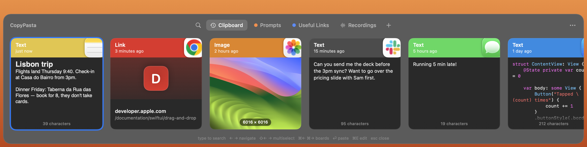
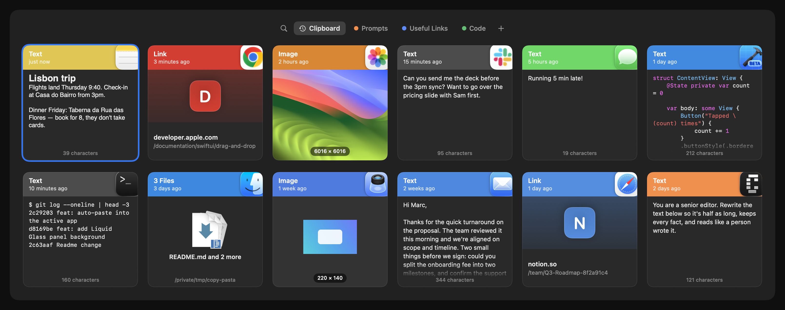
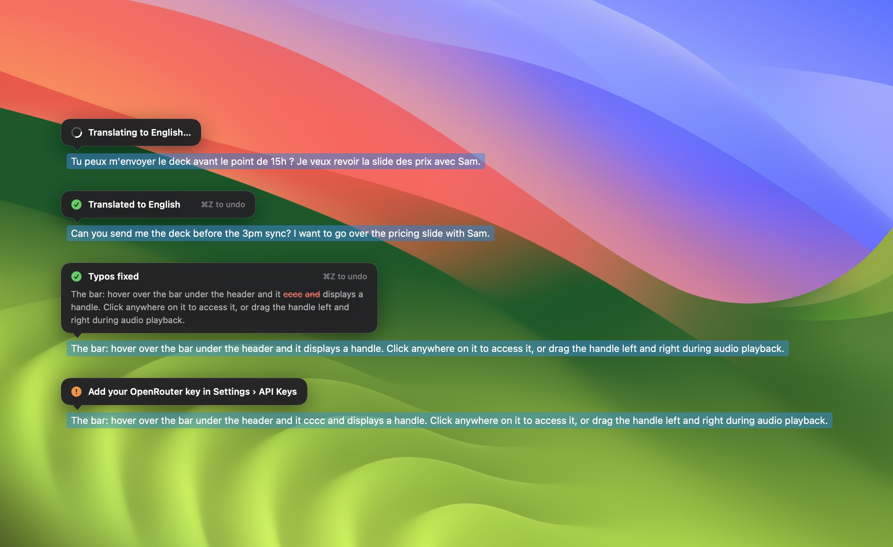
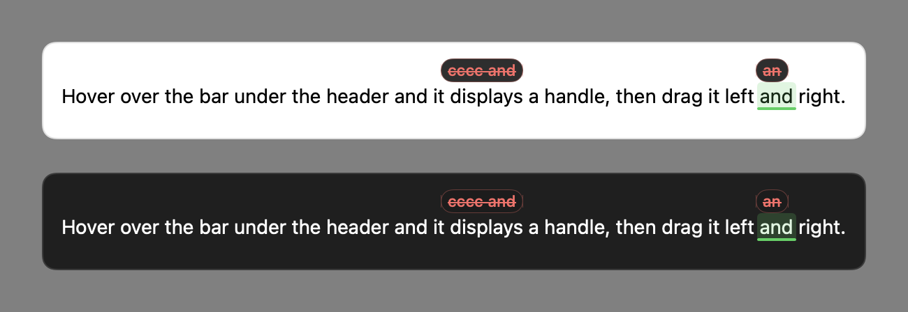
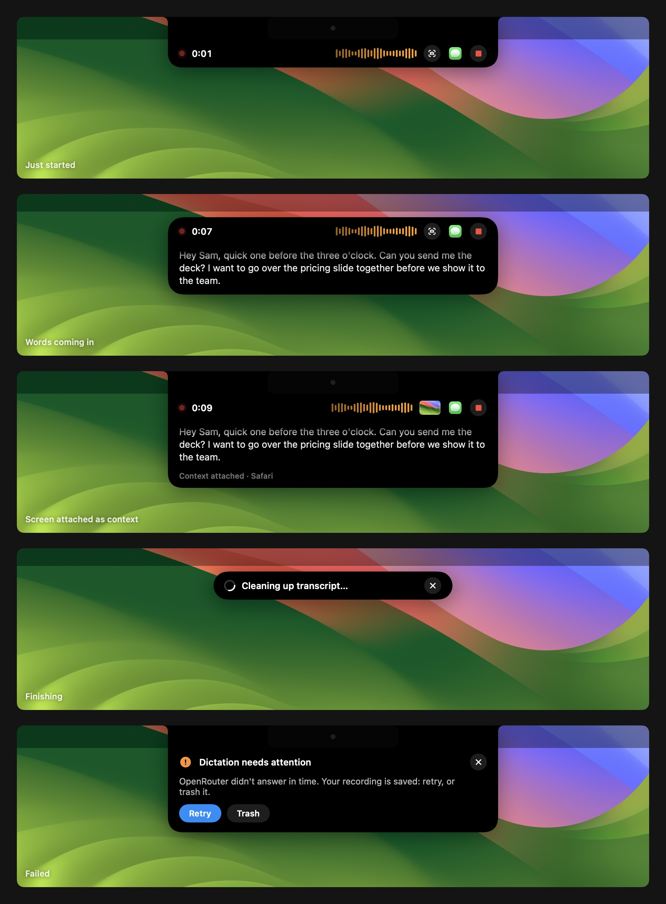
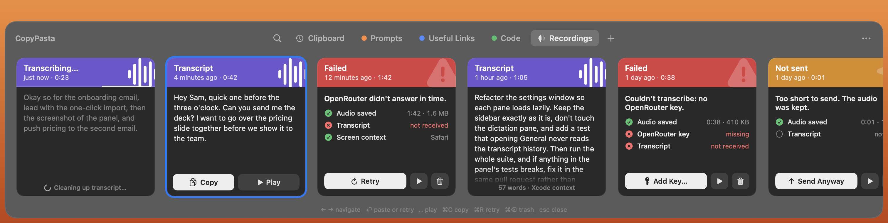
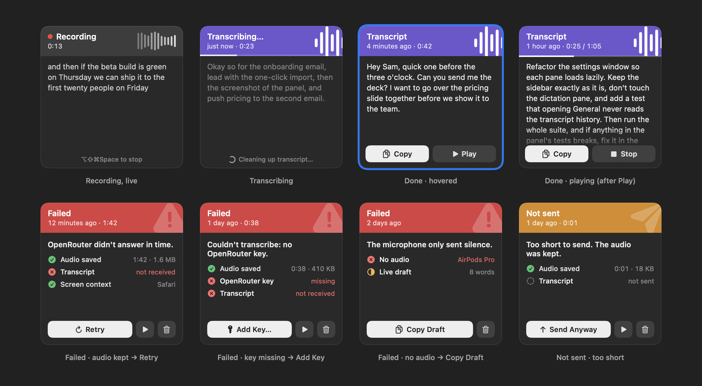
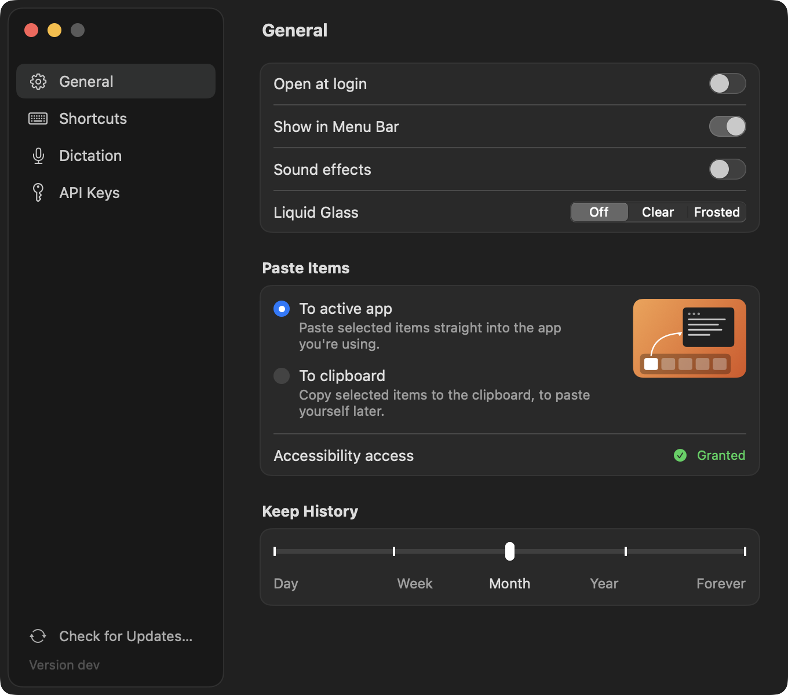
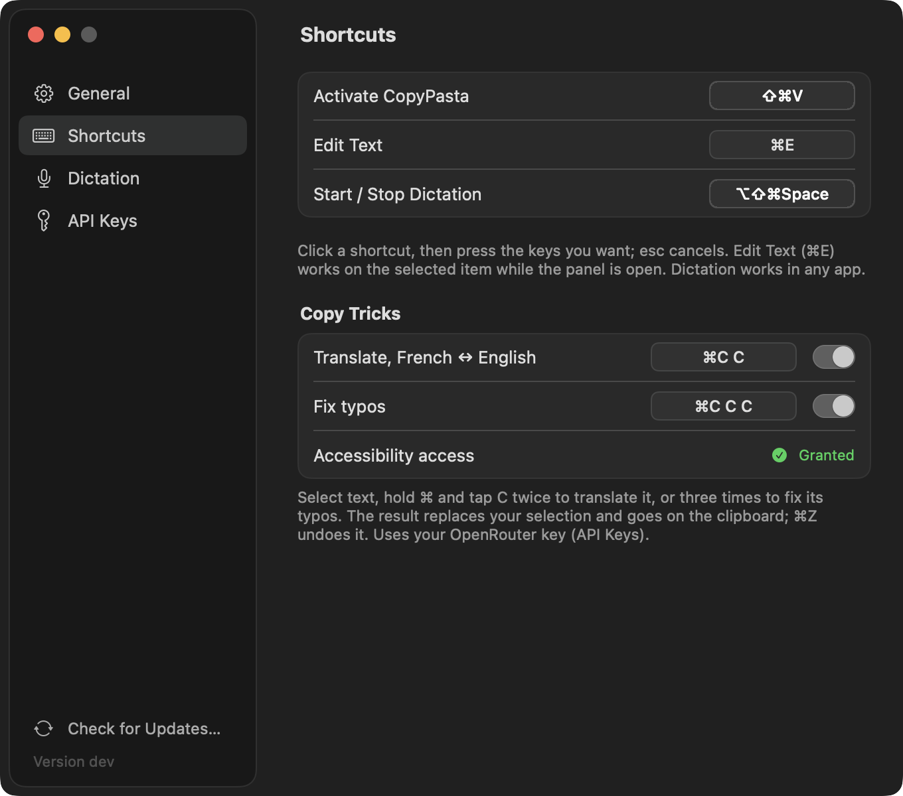
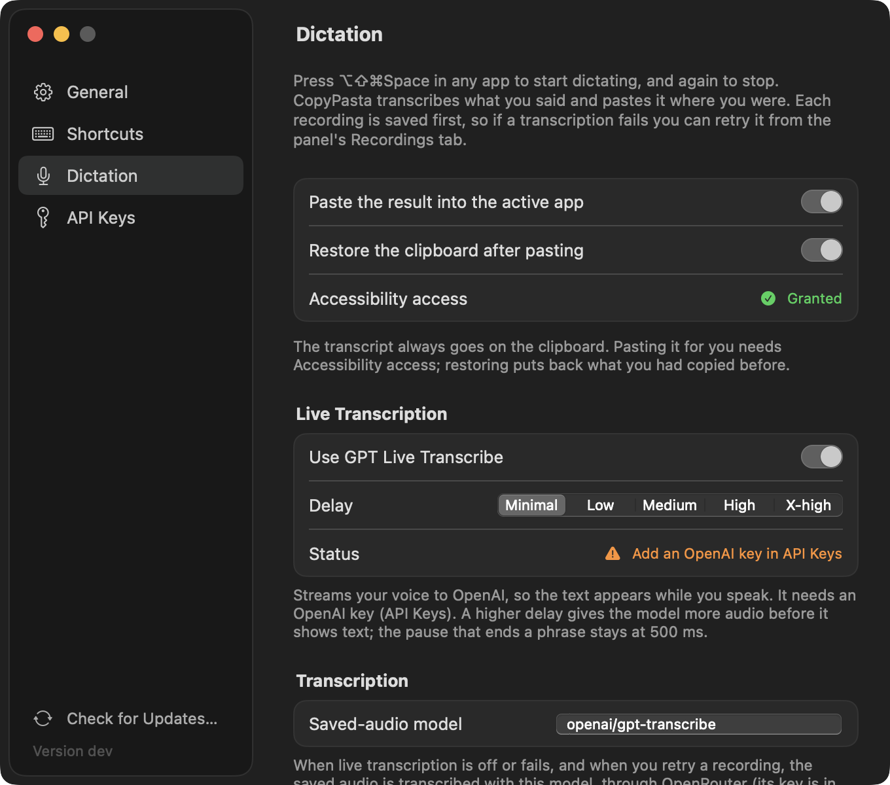

# CopyPasta

A clipboard history manager for macOS, an open-source take on [Paste.app](https://pasteapp.io), with dictation and AI copy tricks built in. It lives in the menu bar, remembers everything you copy, and brings it back with a keystroke.



- **Clipboard history** — text, links, images and files; search covers all of it
- **Boards** — organize snippets into pinboards (Prompts, Code, Useful Links, …)
- **Quick paste** — `⇧⌘V` opens the panel; type to search, `Enter` pastes straight into the app you were in
- **Multi-select** — `Shift`-click or `⇧←/→` a range, paste them all at once: the texts join into one (in order, blank line between), images and files come along as files, like a Finder copy
- **Drag and drop** — drag a card into any app, or onto a pinboard tab to pin it
- **Configurable retention** — keep history a day, week, month, year, or forever
- **Copy Tricks** — select text and press `⌘C` twice to translate it (French ↔ English), three times to fix its typos. The result replaces the selection and lands on the clipboard; `⌘Z` undoes it
- **Dictation** — press `⌥⇧⌘Space` in any app, talk, press it again: CopyPasta types what you said where you were
- **Recordings** — every dictation is kept in the panel's Recordings tab: paste, copy or play it again, and retry a failed one right in its card
- **Launch at login**, rebindable shortcuts, hidden dock icon

CopyPasta used to be called Pastey. The first launch under the new name quits Pastey and moves its history, pinboards and settings over.

Dictation used to be a separate app, SuperSamuel. The first launch copies its settings, API keys, unsent recordings and transcript history into CopyPasta, and leaves SuperSamuel's own copy alone. If that data is over 1 GB, the transcripts come over without their audio, which stays in `~/Library/Application Support/SuperSamuel`.

## Requirements

- macOS 14 (Sonoma) or later
- To build it yourself: [Xcode Command Line Tools](https://developer.apple.com/xcode/resources/) (provides Swift 5.9) — `xcode-select --install`

## Install

**Download** [CopyPasta.dmg](https://github.com/slooowshutter/copy-pasta/releases/latest/download/CopyPasta.dmg), open it and drag CopyPasta into Applications. Or with **Homebrew**:

```bash
brew install --cask slooowshutter/tap/copypasta
```

Both are the release build, signed with a Developer ID and notarized by Apple, so it opens like any app. It updates itself: once a day it checks for a new version and asks before installing it (or menu bar icon › **Check for Updates…**). Homebrew leaves updates to the app.

To build from source instead (takes ~30s):

```bash
git clone https://github.com/slooowshutter/copy-pasta.git
cd copy-pasta
./build.sh install
```

That builds CopyPasta, copies it to `/Applications` and launches it. From then on Spotlight and Raycast find it: search **CopyPasta**.

CopyPasta has no dock icon — it runs from the menu bar. Press `⇧⌘V` to open it.

The first time you press `Enter`, macOS asks to give CopyPasta **Accessibility** access. CopyPasta needs it to type `⌘V` into your app for you. Without it, `Enter` only copies the item and you paste it yourself. You can turn auto-paste off in Settings › General.

### Accessibility permission

CopyPasta needs Accessibility access to paste for you (clipboard items and dictation) and to notice `⌘C` taps for Copy Tricks. macOS ties the permission to the app's code signature. Release builds keep it across updates (same Developer ID). `./build.sh` signs ad-hoc by default, and that signature changes on every build, so **each rebuild loses the permission**: remove CopyPasta from the list in System Settings › Privacy & Security › Accessibility with **−**, then grant access again. The Microphone permission for dictation is lost the same way, and macOS asks for it again at the next recording.

To keep the permission across rebuilds, sign with a certificate. `build.sh` picks a valid Developer ID Application or Apple Development certificate from your keychain on its own (`security find-identity -v -p codesigning` lists yours). Without one, make a self-signed one: **Keychain Access › Certificate Assistant › Create a Certificate…**, Identity Type **Self Signed Root**, Certificate Type **Code Signing**. Then build with `COPYPASTA_SIGN_IDENTITY="<certificate name>" ./build.sh` (export it in your shell profile to make it stick).

## Usage

The panel slides up from the bottom of the screen, over the Dock, without taking you out of the app you're in. Each copy is a card, colored after the app it came from: text keeps its formatting, links show their site, images their size, files their names.



- **`⇧⌘V`** — open / close the panel (rebindable in Settings › Shortcuts)
- **Type** (or `⌘F`) — search everything in the current tab
- **`← →`** — move between cards; **`⌘← ⌘→`** — switch tabs
- **`Enter`** / double-click — paste the selection into the app you were in
- **`Shift`-click** / **`⇧← →`** — select a range to paste together
- **`⌘E`** — edit the selected text item; **`⌘⌫`** — delete the selection
- **Drag a card** — into another app (an image lands as a file), or onto a pinboard tab to pin it (drags the whole selection if the card is part of one)
- **Right-click a card** — paste, copy, pin to a board, delete
- **Click the open board** — rename it; **right-click a board** — rename, color, delete
- **Recordings tab** — your dictations, newest first (see [Dictation](#dictation))
- **`⌥⇧⌘Space`** — start / stop dictation, in any app (rebindable in Settings › Shortcuts; `⌥Space` stays free for SuperSamuel)
- **Menu bar icon** — Settings, check for updates, dictation (unsent recordings, transcript history), pause capture, quit

## Copy Tricks

Select text anywhere, hold `⌘` and tap `C`:

- **`⌘C C`** (twice) — translates it, French ↔ English
- **`⌘C C C`** (three times) — fixes its typos

The result replaces your selection and goes on the clipboard, and `⌘Z` in that app undoes it. A small bubble at the selection says what's happening:



Where the app says where its words are on screen, a typo fix is drawn right on the text for a few seconds, like Grammarly: the new words highlighted in green, the removed ones struck through above them. Elsewhere (many web apps), the bubble shows the changes instead.



Both use [OpenRouter](https://openrouter.ai). Paste your key in **Settings › API Keys** (if SuperSamuel is set up on this Mac, CopyPasta reuses its key), and turn each trick on or off in **Settings › Shortcuts**. The default model, `google/gemma-4-31b-it:nitro`, goes to OpenRouter's fastest provider for it and answers in well under a second. The language is detected on the Mac, so the model is told which way to translate. The result replaces your selection only if you're still in the same app and text field; otherwise it's just on the clipboard.

## Dictation

Press **`⌥⇧⌘Space`** in any app and talk; press it again to stop. The Island at the top of the screen shows the recording, and the text as you speak if live transcription is on. When you stop, CopyPasta pastes the transcript into the app you were in (it's also on the clipboard). While recording you can attach a screenshot of that app as context, so names on screen are spelled right.



It needs an [OpenRouter](https://openrouter.ai) key, the same one Copy Tricks uses, and live transcription (text while you speak) also needs an **OpenAI** key: paste both in **Settings › API Keys**. Both keys stay on this Mac, in files only you can read. Optional text cleanup has a model edit the transcript (fillers, punctuation) with instructions you can change, and a personal dictionary helps with names and jargon.

### Recordings

Every recording is saved before it's sent, so nothing is lost when the network drops. The panel's **Recordings** tab shows them all, newest first: the one in progress (words coming in), finished transcripts (`Enter` pastes, `⌘C` copies, `Space` plays the audio), and any that failed or weren't sent, with what was kept and what went wrong.



A failed card's main button fixes it: **Retry** transcribes the saved audio again right in the card, with the panel still open, and the card turns into the transcript, ready to paste. **Add Key…** opens Settings when the OpenRouter key is missing; **Send Anyway** sends one that was kept without being sent (too short, or cancelled).



The menu bar icon has them too (**Unsent Recordings**, **Transcript History**). Recordings and transcripts live in `~/Library/Application Support/CopyPasta/Dictation`.

The first recording asks for **Microphone** access. Pasting for you needs **Accessibility** (the same permission as auto-paste), and a screenshot needs **Screen Recording**.

## Settings

Open from the menu bar icon › **Settings…**, or the panel's **•••** menu:

- **General** — launch at login, menu bar icon, sound effects, Liquid Glass panel background, paste into the active app or only copy (and its Accessibility status), how long to keep history
- **Shortcuts** — rebind Activate CopyPasta and Start / Stop Dictation: click one and press the new keys (a reset arrow appears once it's changed). If another app (the real Paste, Maccy, …) already uses one, CopyPasta warns you here (and at launch, for open/close). Copy Tricks are turned on or off here too
- **Dictation** — pasting and restoring the clipboard, live transcription (delay), saved-audio model, text cleanup (model, instructions), personal dictionary
- **API Keys** — the OpenRouter key (Copy Tricks, dictation) and Copy Tricks' model, and the OpenAI key (live transcription)

| General | Shortcuts | Dictation |
| --- | --- | --- |
|  |  |  |

## Importing from Paste.app

Moving from Paste (Setapp)? Quit CopyPasta, then run `/Applications/CopyPasta.app/Contents/MacOS/CopyPasta import-paste`: it brings your whole history and every pinboard across (rich text, images, files, links), with their names, colors and order. Paste's data is only read; running it again adds only what's new.

## Development

```bash
./build.sh run          # build + relaunch dist/CopyPasta.app
./build.sh install      # build + install to /Applications + launch
CopyPasta --toggle         # open/close the running instance's panel
CopyPasta --snapshot       # debug builds: render the panel to copypasta-panel.png in Application Support
CopyPasta --settings       # debug builds: open Settings and render it to copypasta-settings.png
```

Debug builds can also render the cards and the drawer to PNGs without showing anything on screen (sample data, not your history), and run the self-checks. The screenshots in `docs/images` come from these:

```bash
swift build
.build/debug/CopyPasta --render-cards cards.png
.build/debug/CopyPasta --render-panel panel.png
.build/debug/CopyPasta --render-recordings recordings.png   # + recordings-states.png
.build/debug/CopyPasta --render-tricks tricks.png           # + tricks-island.png (dictation), tricks-inline.png
.build/debug/CopyPasta --render-settings settings.png --pane Dictation --tall   # sample values, not yours
.build/debug/CopyPasta --check-migration     # Pastey → CopyPasta move, on throwaway folders
.build/debug/CopyPasta --check-copy-tricks   # language detection, whitespace handling
.build/debug/CopyPasta --check-dictation-import   # SuperSamuel → CopyPasta copy, on throwaway folders
swift test                                   # dictation's tests (the two paid API checks are opt-in)
```

`dictation/` holds dictation's benchmarks and notes: `CopyPasta benchmark --help` compares transcription strategies on a folder of audio clips, `dictation/benchmark/recording_benchmark.py` compares models on your Transcript History, and `VALIDATION.md` / `MODEL_RESEARCH.md` record how the defaults were chosen.

History is stored in a SQLite database at `~/Library/Application Support/CopyPasta/copypasta.db`.

The app icon is `Resources/AppIcon.svg`; `scripts/make_icon.sh` renders it into `Resources/AppIcon.icns` (needs `brew install librsvg`). Commit both.

## Releasing

Push a version tag on `main`:

```bash
git tag -a v0.2.0 -m "What's new in 0.2.0…"   # the message becomes the release notes
git push origin v0.2.0
```

The [Release workflow](.github/workflows/release.yml) runs the tests, builds the app for Apple silicon and Intel, signs it with Developer ID, notarizes it, packs it in a notarized `CopyPasta.dmg`, writes the Sparkle feed (`appcast.xml`), publishes the GitHub release with both, and updates the Homebrew cask. Installed copies pick the update up within a day. The version comes from the tag; the build number, which updates compare, is the commit count, hence releasing from `main`. A tag like `v0.3.0-beta.1` makes a pre-release that updates and Homebrew ignore.

The app reads its feed from `…/releases/latest/download/appcast.xml`, which GitHub always serves from the newest release: no server to run. The workflow publishes a release only once both files are on it.

`scripts/release.sh` does the same build locally, into `dist/` (`--help` lists its settings). Without a Developer ID certificate it makes an ad-hoc signed, un-notarized DMG, for testing only.

### One-time setup

1. **Developer ID certificate.** In Xcode › Settings › Accounts, select the team, **Manage Certificates… › + › Developer ID Application** (only the team's Account Holder can create one). In Keychain Access › My Certificates, right-click it › **Export…** as a `.p12` with a password.
2. **Notarization key.** [App Store Connect](https://appstoreconnect.apple.com/access/integrations/api) › Users and Access › Integrations › Team Keys › **+**, access **Developer**. Download the `AuthKey_<KEYID>.p8` (it's offered only once), and note the Key ID and the Issuer ID above the list.
3. **Sparkle update key.** It signs every update, and the app installs only updates signed with it:
   ```bash
   swift package resolve
   .build/artifacts/sparkle/Sparkle/bin/generate_keys              # keeps the private key in your keychain, prints the public key
   .build/artifacts/sparkle/Sparkle/bin/generate_keys -x sparkle_private_key   # a copy for CI
   ```
   Put the public key in `Info.plist` as `SUPublicEDKey` (replacing `REPLACE_WITH_SPARKLE_PUBLIC_ED_KEY`) and commit it. Back the private key up, in a password manager: without it, installed copies can't be updated anymore.
4. **Homebrew tap.** Create the public repo `slooowshutter/homebrew-tap`, with a README. Then a [fine-grained token](https://github.com/settings/personal-access-tokens/new) for that repo only, with **Contents: Read and write**.
5. **Secrets.** From this repo's folder:
   ```bash
   base64 -i DeveloperID.p12 | gh secret set DEVELOPER_ID_P12_BASE64
   gh secret set DEVELOPER_ID_P12_PASSWORD          # prompts for it
   gh secret set NOTARY_API_KEY_P8 < AuthKey_<KEYID>.p8
   gh secret set NOTARY_API_KEY_ID --body <KEYID>
   gh secret set NOTARY_API_ISSUER_ID --body <issuer ID>
   gh secret set SPARKLE_PRIVATE_KEY < sparkle_private_key
   gh secret set HOMEBREW_TAP_TOKEN                 # prompts for the token
   ```
   Then delete the exported files (`DeveloperID.p12`, `sparkle_private_key`); keep the `.p8` somewhere safe.

To release from this Mac instead: `xcrun notarytool store-credentials copypasta --key AuthKey_<KEYID>.p8 --key-id <KEYID> --issuer <issuer ID>` once, then `NOTARY_KEYCHAIN_PROFILE=copypasta scripts/release.sh` on a tagged commit, and upload `dist/CopyPasta.dmg` and `dist/appcast.xml` to the release.
